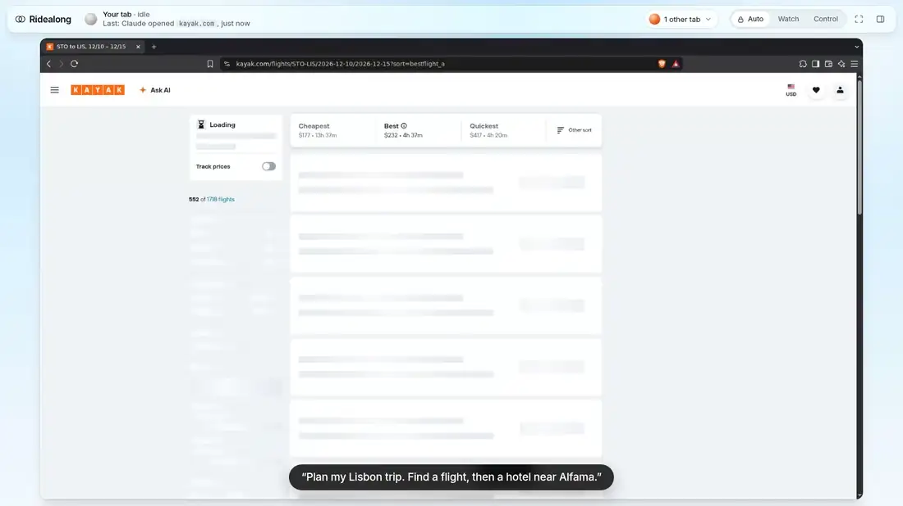
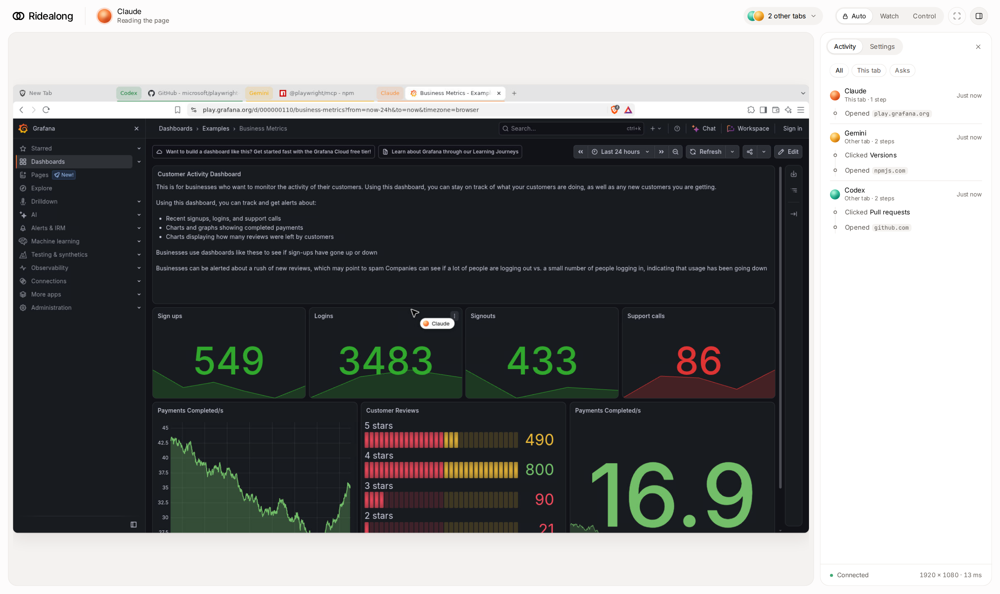
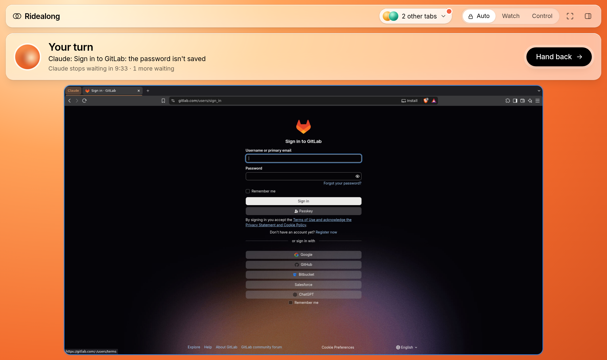
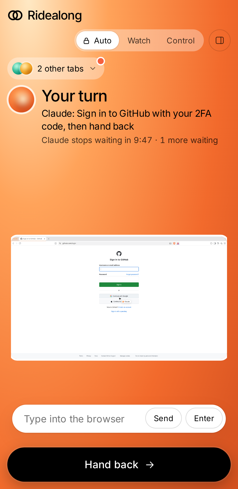
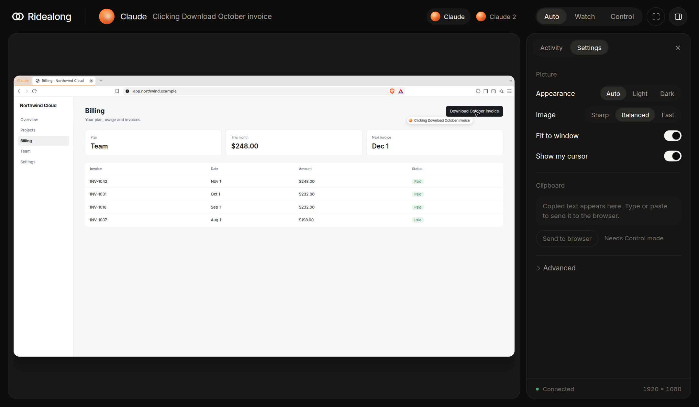
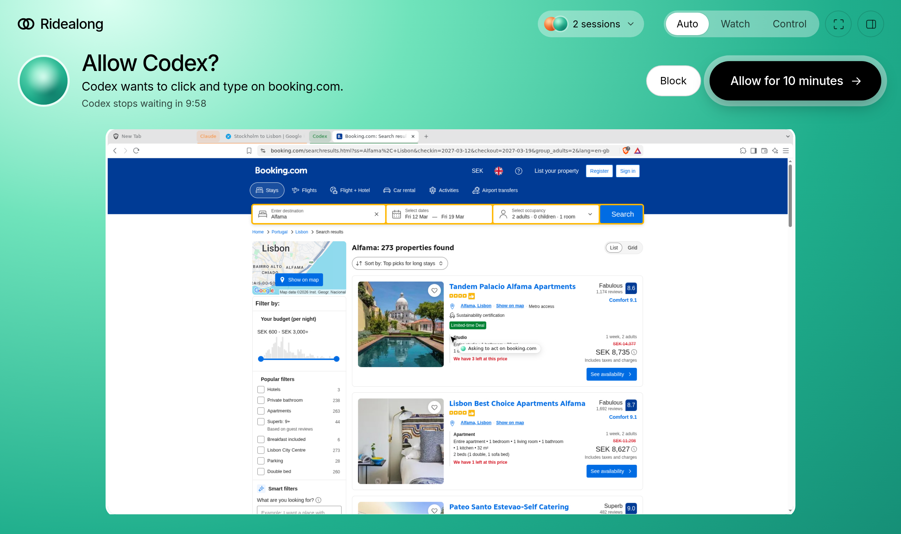
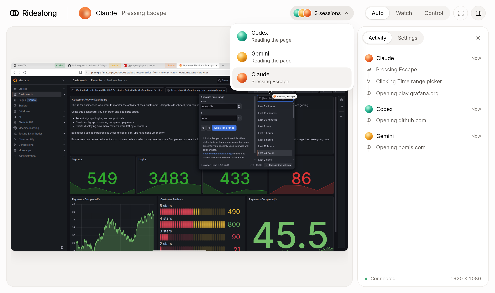

<h1> Ridealong</h1>

**A real browser for any AI agent. Plug it into anything that speaks MCP, ride along, and take the wheel when you need to.**

Ridealong runs a real, logged-in Brave browser on your server. Claude Code, Codex, Gemini CLI, Cursor or any other MCP client can drive it. You follow along live from a web viewer, and when an agent hits a 2FA code or a CAPTCHA, it asks you to step in and carries on when you hand back.

[](docs/demo.mp4)

<sub>Real agent sessions on real sites through Ridealong. The steps are scripted, the check is a public test page, and pauses are cut. [Watch the full-size video](docs/demo.mp4).</sub>



## Why

Agents get stuck wherever there's no API: dashboards, admin panels, anything behind a login. Headless browsers can't get past 2FA, and you can't see what they're doing. Ridealong gives agents a real browser that stays signed in, and gives you a live view with a clean way to step in.

- **Real browser:** Brave with its own profile, so logins persist. It runs in a locked-down container, survives crashes and reboots, and starts on a clean tab.
- **Live viewer:** see the agent's cursor and what it's doing, from any device.
- **Human handover:** the agent asks, the whole screen tells you it's your turn, you hand back. It waits for you and resumes on its own.
- **Safe by default:** the viewer is locked while agents work, and agents pause when you take control.
- **Plug and play:** one command connects any MCP client. There are no providers or plugins to add, and any model works.
- **Parallel agents:** every session gets its own tab, so they can work at the same time. Switch between them from a dropdown.

## Install

You need Linux with Docker and Compose. It's tested on Ubuntu 24.04 (x86-64).

```
git clone https://github.com/Christian-Gennari/ridealong
cd ridealong
./ridealong up
```

It downloads about 350 MB the first time, prints your viewer link and connects the MCP clients it finds. Then open the viewer, choose **Control**, sign into your accounts in Brave, and go back to **Auto**.

Everything runs in one container, so nothing is installed on the server except the `ridealong` command in `~/.local/bin`. It starts again on its own after a reboot.

| Command | What it does |
|---|---|
| `ridealong up` | Start it, building it the first time |
| `ridealong down` | Stop it |
| `ridealong restart` | Restart it |
| `ridealong status` | Show whether it's healthy and where to find it |
| `ridealong logs` | Follow the logs |
| `ridealong update` | Get the latest version, including Brave, and restart |
| `ridealong connect` | Connect MCP clients you've installed since |
| `ridealong uninstall` | Remove the container and agent config, keeping your profile and files |

Brave only updates with the image, which is rebuilt every week, so run `ridealong update` regularly. The viewer reminds you after 14 days.

Moving from an older install that ran directly on the server? Run `./ridealong migrate`. It asks for `sudo` once, removes that install and carries on with your existing Brave profile.

## Using it

| Mode | What happens |
|---|---|
| **Auto** | Locked while agents work, so a stray click can't disturb them. Unlocks when one asks for you, and locks again when you hand back. |
| **Watch** | Always locked. If an agent asks for you, the viewer offers to unlock. |
| **Control** | The browser is yours, and agents wait until you release it. |

Want to step in while an agent is working? Press **Control**, or click the screen and choose **Take control**. The agent finishes its current action and waits until you release it.

When an agent needs you, the whole viewer floods with that agent's colour and says **Your turn**, with the reason and how long it will wait. The browser stays clear in the middle and takes your keyboard straight away. Do what it asks and press **Hand back**.



Your agent's app hears about it too: Claude Code, and any client that supports MCP elicitation, shows the reason with a link to the viewer, and the prompt clears itself once you hand back. You can also answer it right there. Claude Code and Codex show it, and Gemini CLI and Hermes support it too. A client that can't show it declines on its own, and Ridealong keeps waiting for you in the viewer. The viewer also chimes and blinks its tab title.

To hear about it with no viewer open at all, press **Turn on** when the viewer offers notifications, once on each device you use. They arrive as real push notifications even with the viewer closed, in Chrome, Edge, Firefox and Safari. On an iPhone, add the viewer to your Home Screen first, which Apple requires. Brave needs **Use Google services for push messaging** turned on in its settings. To get a push on your phone when nothing's open, pass a URL, such as an [ntfy](https://ntfy.sh) topic: `ridealong up --notify https://ntfy.sh/your-secret-topic`. The reason the agent gave goes to that URL, so use one you trust.

On a phone or tablet, the viewer adds a **Type into the browser** box whenever the screen is unlocked, because touch keyboards can't type into a remote screen. Tap the field in the browser, type or paste your code in the box, and press **Send**.



Activity and settings live in the sidebar, in light or dark.



## Site rules

Under **Settings**, list the sites where agents must ask first, such as your bank, PayPal or your domain registrar. Agents can still read those sites. When one tries to click or type there, the viewer asks you to allow it for 10 minutes or block it. The check runs in Ridealong's wrapper, not in the agent, so a page can't talk an agent past it, and if the viewer is down the answer is no.



While any rule is set, `browser_run_code_unsafe` is turned off, because it could reach a protected site and act in one call.

Rules protect the page in front of the agent. They can't stop a script on another site from sending requests with your cookies, and an agent with a shell on the server could change them.

## Parallel agents

Every agent session gets its own tab and its own label (Claude, Claude 2, and so on), so sessions can work at the same time without touching each other's pages. They share one browser, so they also share logins. The tabs are grouped by session and close when the session ends.

The screen stays on one session rather than flipping between them. With two or more running, the **sessions** dropdown in the top bar shows what each one is doing and which one needs you. Pick one to watch it, or in Control mode click its tab in Brave: the two always stay in sync. If several sessions need you, their requests queue, and each comes forward in turn.



Isolation is per MCP connection. Subagents that share one connection also share one tab, so give browser work to one subagent at a time.

## Reaching the viewer

The viewer controls a logged-in browser, so it stays on `127.0.0.1` unless you choose otherwise. `ridealong up` picks the option automatically; override it with `--network`.

| Option | How | Best for |
|---|---|---|
| **Tailscale** (recommended) | Detected automatically. Gives a private `https://` link. | Any device, including your phone, with no open ports. |
| **SSH tunnel** | The default without Tailscale: `ssh -L 6086:127.0.0.1:6086 you@server`, then open `http://127.0.0.1:6086`. | Occasional use, nothing to install. |
| **Your own proxy** | Point Cloudflare Tunnel or a reverse proxy at `127.0.0.1:6086`, with your own login in front, and tell the viewer its address: `--allow-host viewer.example.com`. | If you already run one. |
| **LAN** | `--network lan` gives a secret link over plain HTTP. | Trusted home networks only. |

Never expose the viewer to the internet without a login in front of it.

## Connect any MCP client

Ridealong is a standard MCP server, so it's plug and play: if a tool can run a local MCP server, it works, whichever model is behind it. Everything points at one command, `ridealong mcp`, which also starts the container if it's stopped.

`ridealong up` connects Claude Code, Codex, Gemini CLI and Hermes if it finds them. For anything else:

```bash
claude mcp add ridealong -- ridealong mcp --agent Claude      # Claude Code
codex mcp add ridealong -- ridealong mcp --agent Codex        # Codex
gemini mcp add ridealong ridealong mcp --agent Gemini         # Gemini CLI
```

Tools configured with JSON, like Cursor and Claude Desktop, use this:

```json
{
  "mcpServers": {
    "ridealong": { "command": "ridealong", "args": ["mcp", "--agent", "Cursor"] }
  }
}
```

`--agent` is the name you'll see in the viewer. Clients receive the usage rules when they connect. If your client has a tool timeout, set it above 11 minutes, because `browser_handover` waits up to 10 for you. `ridealong connect` does this for Codex and Hermes.

The ChatGPT web and desktop apps can't use it: they only connect to remote MCP servers, and this one shouldn't be exposed to the internet. Use Codex instead.

## Files and localhost

Brave runs in a container, so it sees only one folder of yours, `~/ridealong-files`. Agents upload from it and downloads land in it. It has the same path inside and out, so the paths agents get back work as they are.

`localhost` in this browser is the container, not your server. To let agents open a dev server running on the machine, use `ridealong up --host-network`. Brave then shares the server's network, so you give up the network isolation.

## How it works

One container runs Xvfb, a bare window manager, Brave, x11vnc and the viewer, with a small supervisor that brings back whatever stops. If Brave freezes, the viewer offers to restart it. Brave's profile lives in `~/.ridealong-browser` on the server, so logins survive updates.

`ridealong mcp` runs a small wrapper inside the container, in front of a pinned `@playwright/mcp`. It tells the viewer and a browser extension what's happening, adds a short pause before each click so you can follow it, holds tools while you have control, and adds the `browser_handover` tool. If the viewer goes down, agents keep working and rejoin when it comes back.

Only the viewer port leaves the container. VNC and Brave's debugging port stay inside it.

To work on Ridealong itself, run `ridealong up --build`, `npm test` in `viewer/`, and `scripts/smoke` to boot the real image.

## Security

Treat Ridealong as giving your agents your logged-in browser, and sign in only where you'd accept that.

- **Agents read untrusted pages**, so prompt injection is a real risk. They're told to treat page text as data, which reduces the risk but doesn't remove it. Set [site rules](#site-rules) for anything that matters.
- **The container is locked down:** it runs as your user with a read-only filesystem, no capabilities except `SYS_CHROOT`, and no new privileges. Brave's own sandbox stays on, which is why `docker/seccomp.json` adds namespaces to Docker's default profile. A compromised page has to escape Brave's sandbox and then the container, and even then it finds only your Brave profile and shared folder.
- **Saved passwords are stored unencrypted** in `~/.ridealong-browser`, because there's nobody at boot to unlock a keyring. Any process running as your user can read them. Keep payment and other high-value accounts out of this profile.
- **Anyone in the `docker` group is effectively root,** and can open a shell in the container. That's true of Docker in general.
- **The viewer has no login of its own,** except the secret link in LAN mode. The lock protects against accidents, not people.
- **Other websites can't reach it:** the viewer refuses other origins, and any address it wasn't set up with, which stops DNS rebinding.

## License

MIT. noVNC (MPL-2.0) and Inter (OFL) are included under their own licenses.
